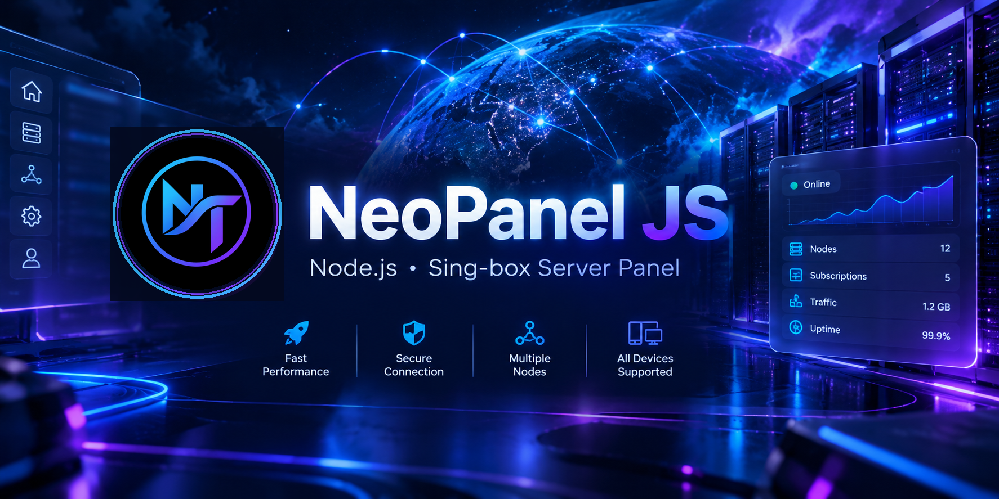

<div align="center">

# NeoPanel JS

**پنل مدیریت سرورهای Node.js و سرویس‌های شخصی بر پایه Sing-box**

A lightweight, self-hosted Node.js control panel for managing personal proxy services, nodes, and subscription links around Sing-box.

[](https://nodejs.org/)
[](LICENSE)
[](#open-source)
[](https://t.me/NeoTenet)

</div>

<p align="center">
  
</p>

---

## 🇮🇷 فارسی

### NeoPanel JS چیست؟

**NeoPanel JS** یک پنل وب سبک و متن‌باز برای سرورهای **Node.js** است که مدیریت سرویس‌های شخصی مبتنی بر **Sing-box** را ساده‌تر می‌کند.

پنل روی سرور خودتان اجرا می‌شود و از یک رابط وب برای مشاهده وضعیت سرور، مدیریت نودها و دریافت لینک‌های اتصال و اشتراک استفاده می‌کند. بخش وب پنل به‌صورت داخلی داخل `index.js` قرار گرفته و برای اجرای رابط کاربری به فایل‌های فرانت‌اند جداگانه نیاز ندارد.

### چه کاری انجام می‌دهد؟

- اجرای یک پنل وب روی سرور شخصی
- مدیریت و تولید نودهای پروکسی بر پایه Sing-box
- ساخت لینک‌های اتصال و Subscription
- ارائه خروجی برای کلاینت‌های مختلف
- نمایش وضعیت سرور، پورت، هاست و زمان فعالیت
- نمایش نودها و لینک‌های ساخته‌شده
- رابط فارسی و انگلیسی
- حالت شب و روز
- رابط شیشه‌ای و واکنش‌گرا برای موبایل و دسکتاپ
- استفاده از یک پورت عمومی برای پنل و ترافیک اصلی

### پروتکل‌ها

بسته به تنظیمات، پروژه از چند نوع سرویس و پروتکل پشتیبانی می‌کند. در تنظیمات پیش‌فرض، گزینه‌های اصلی شامل موارد زیر هستند:

- Hysteria 2
- VLESS WebSocket
- VLESS HTTP Upgrade
- VLESS gRPC
- Trojan WebSocket
- ShadowTLS / VLESS
- Shadowsocks

گزینه‌هایی مثل XHTTP، TUIC، SOCKS، HTTP Proxy و Argo نیز در کد پیش‌بینی شده‌اند و می‌توانند از طریق تنظیمات فعال شوند.

### فرمت‌های Subscription

پنل می‌تواند خروجی‌های مختلفی برای کلاینت‌ها تولید کند، از جمله:

- لینک‌های URI و Base64
- Hiddify / V2Ray compatible links
- Clash Meta YAML
- Sing-box JSON
- Xray-compatible output

### پیش‌نیازها

1. یک سرور یا VPS که بتواند Node.js را اجرا کند.
2. **Node.js 18 یا بالاتر**.
3. `npm`.
4. دسترسی شبکه برای دریافت وابستگی‌ها و در اولین اجرا، در صورت نبود فایل باینری، دریافت Sing-box.
5. روی Linux وجود ابزار `tar` برای استخراج نسخه دانلودشده Sing-box لازم است.

---

## 🚀 نصب و اجرا

### 1. دریافت پروژه

```bash
git clone <YOUR_REPOSITORY_URL>
cd NeoPanel_JS
```

اگر فایل‌ها را به‌صورت ZIP دریافت کرده‌اید، ZIP را روی سرور استخراج کنید و وارد پوشه پروژه شوید.

### 2. نصب وابستگی‌ها

```bash
npm install
```

### 3. اجرای پنل

```bash
npm start
```

یا:

```bash
node index.js
```

بعد از اجرا، آدرس پنل به‌صورت پیش‌فرض شبیه این خواهد بود:

```text
http://SERVER_IP:2705/neotenet
```

پورت پیش‌فرض `2705` است و مسیر پنل پیش‌فرض `/neotenet` است.

> در اولین اجرا، اگر فایل Sing-box وجود نداشته باشد، اسکریپت نسخه تنظیم‌شده Sing-box را برای سیستم‌عامل و معماری سرور دریافت و آماده می‌کند.

---

## ⚙️ تنظیمات

تنظیمات اصلی در ابتدای `index.js` داخل بخش `BK_CONFIG` قرار دارند. همچنین بسیاری از گزینه‌ها را می‌توان با Environment Variable تغییر داد.

### تنظیمات مهم

| Variable | کاربرد |
|---|---|
| `PORT` | تغییر پورت عمومی سرور |
| `SERVER_PORT` | جایگزین برای پورت عمومی |
| `SB_PORT` | جایگزین برای پورت عمومی |
| `UUID` | تعیین UUID ثابت |
| `DOMAIN` | تعیین دامنه عمومی سرور |
| `FORCE_HOST` | تعیین Host/IP مورد استفاده در لینک‌ها |
| `PANEL_PATH` | تغییر مسیر پنل |
| `PANEL_TOKEN` | فعال‌کردن احراز هویت پنل |
| `NODE_PREFIX` | تغییر پیشوند نام نودها |
| `SNI_HY2` | تعیین SNI برای Hysteria 2 |
| `ALLOW_LOCALHOST_LINKS` | اجازه تولید لینک‌های localhost |

### نمونه اجرا با تنظیمات سفارشی

```bash
PORT=8080 DOMAIN=example.com PANEL_PATH=panel PANEL_TOKEN='CHANGE_ME' node index.js
```

در این حالت پنل روی مسیر زیر در دسترس خواهد بود:

```text
http://example.com:8080/panel
```

### امنیت پنل

اگر پنل را روی اینترنت عمومی قرار می‌دهید، توصیه می‌شود برای آن `PANEL_TOKEN` تعیین کنید.

```bash
export PANEL_TOKEN='یک-توکن-قوی-و-تصادفی'
npm start
```

توکن پنل می‌تواند برای احراز هویت درخواست‌ها استفاده شود. از قرار دادن توکن واقعی داخل README یا کد عمومی خودداری کنید.

---

## 🔗 مسیرهای مهم

با مسیر پیش‌فرض `/neotenet`، نمونه مسیرهای اصلی عبارت‌اند از:

```text
/neotenet
/neotenet/base64
/neotenet/hiddify
/neotenet/clash
/neotenet/sb/raw
/neotenet/xray/raw
```

مسیرهای Subscription برای کلاینت‌ها و فرمت‌های مختلف طراحی شده‌اند و از همان تنظیمات نودهای پروژه استفاده می‌کنند.

---

## 🧩 ساختار ساده پروژه

```text
NeoPanel_JS/
├── index.js       # هسته برنامه + پنل وب Embedded
├── package.json   # وابستگی‌ها و اسکریپت‌های اجرا
├── README.md      # مستندات پروژه
├── banner.png     # بنر صفحه GitHub
├── logo.jpg       # لوگوی پروژه
└── LICENSE        # مجوز MIT
```

پنل وب داخل `index.js` قرار گرفته است؛ بنابراین برای رابط کاربری اصلی نیاز به یک پروژه جداگانه React/Vue یا یک build step جدا ندارید.

---

## 📱 موبایل و دسکتاپ

رابط کاربری برای نمایش در دسکتاپ و موبایل طراحی شده و از زبان فارسی و انگلیسی و حالت‌های روشن و تاریک پشتیبانی می‌کند.

---

## 💡 مناسب چه کسانی است؟

NeoPanel JS برای افرادی مناسب است که می‌خواهند:

- روی VPS یا سرور شخصی خود یک پنل سبک Node.js داشته باشند.
- سرویس‌های شخصی Sing-box را مدیریت کنند.
- لینک‌های نود و Subscription را در یک پنل وب در اختیار داشته باشند.
- بدون ساخت یک Frontend جداگانه، یک رابط آماده و واکنش‌گرا داشته باشند.

---

## 🔓 Open Source

این پروژه **متن‌باز (Open Source)** است و تحت مجوز **MIT** منتشر شده است.

می‌توانید کد را بررسی، اجرا، شخصی‌سازی و مطابق شرایط مجوز MIT استفاده کنید.

---

## 📣 NeoTenet

برای آموزش‌ها، ابزارها، پروژه‌ها و مطالب مرتبط با Node.js، سرور و تکنولوژی‌های مختلف، کانال NeoTenet را دنبال کنید:

**Telegram:** https://t.me/NeoTenet

ساخته شده توسط **NeoTenet**.

---

## ⚠️ نکات مهم

- قبل از اجرای پروژه روی سرور عمومی، تنظیمات امنیتی و Firewall سرور خود را بررسی کنید.
- برای پنل عمومی حتماً از `PANEL_TOKEN` یا یک لایه احراز هویت مناسب استفاده کنید.
- مسئولیت نحوه استفاده از این نرم‌افزار، تنظیمات سرور و ترافیک شبکه بر عهده مدیر سرور است.

---

# 🇺🇸 English (US)

## What is NeoPanel JS?

**NeoPanel JS** is a lightweight, open-source web panel for **Node.js servers** that makes it easier to manage personal proxy services built around **Sing-box**.

It runs directly on your own server and provides a web interface for checking server status, managing generated nodes, and accessing connection and subscription outputs. The web UI is embedded inside `index.js`, so the main panel does not require a separate frontend build.

## What does it do?

- Runs a self-hosted web control panel
- Manages and generates Sing-box based proxy nodes
- Generates connection links and subscription outputs
- Provides multiple client-friendly output formats
- Shows server status, public port, host/IP, and uptime
- Displays generated nodes and links
- Persian and English interface
- Light and dark modes
- Responsive glass-style UI for desktop and mobile
- Uses a single public entry port for the panel and main traffic routing

## Supported protocols

Depending on the configuration, the project supports multiple protocols and services. The main defaults include:

- Hysteria 2
- VLESS WebSocket
- VLESS HTTP Upgrade
- VLESS gRPC
- Trojan WebSocket
- ShadowTLS / VLESS
- Shadowsocks

Optional components such as XHTTP, TUIC, SOCKS, HTTP Proxy, and Argo are also available in the configuration and can be enabled when needed.

## Subscription formats

NeoPanel JS can generate outputs for different clients, including:

- URI and Base64 links
- Hiddify / V2Ray compatible links
- Clash Meta YAML
- Sing-box JSON
- Xray-compatible output

## Requirements

- A VPS, server, or host capable of running Node.js
- **Node.js 18 or newer**
- `npm`
- Network access for dependency installation and, when needed, downloading Sing-box on first run
- On Linux, the `tar` utility is required to extract the downloaded Sing-box archive

## Installation

### 1. Clone the repository

```bash
git clone <YOUR_REPOSITORY_URL>
cd NeoPanel_JS
```

If you downloaded the project as a ZIP file, extract it on your server and enter the project directory.

### 2. Install dependencies

```bash
npm install
```

### 3. Start the panel

```bash
npm start
```

Or:

```bash
node index.js
```

By default, the panel will be available at:

```text
http://SERVER_IP:2705/neotenet
```

The default public port is `2705` and the default panel path is `/neotenet`.

> On the first run, if the Sing-box binary is not already available, the script downloads and prepares the configured Sing-box version for the detected operating system and architecture.

## Configuration

The main configuration is available near the top of `index.js` inside `BK_CONFIG`. Many settings can also be overridden through environment variables.

| Variable | Purpose |
|---|---|
| `PORT` | Change the public server port |
| `SERVER_PORT` | Alternative public port variable |
| `SB_PORT` | Alternative public port variable |
| `UUID` | Set a fixed UUID |
| `DOMAIN` | Set the public server domain |
| `FORCE_HOST` | Force the host/IP used in generated links |
| `PANEL_PATH` | Change the web panel path |
| `PANEL_TOKEN` | Enable panel authentication |
| `NODE_PREFIX` | Change the node name prefix |
| `SNI_HY2` | Set the Hysteria 2 SNI |
| `ALLOW_LOCALHOST_LINKS` | Allow localhost links in generated output |

### Example

```bash
PORT=8080 DOMAIN=example.com PANEL_PATH=panel PANEL_TOKEN='CHANGE_ME' node index.js
```

The panel will then use:

```text
http://example.com:8080/panel
```

### Panel security

If the panel is exposed to the public Internet, set a strong `PANEL_TOKEN`.

```bash
export PANEL_TOKEN='use-a-long-random-token'
npm start
```

Do not publish real secrets, UUIDs, tokens, or private server information in your repository.

## Main routes

With the default `/neotenet` panel path, common routes include:

```text
/neotenet
/neotenet/base64
/neotenet/hiddify
/neotenet/clash
/neotenet/sb/raw
/neotenet/xray/raw
```

These subscription routes use the nodes generated by the same server configuration.

## Project structure

```text
NeoPanel_JS/
├── index.js       # Core application + embedded web panel
├── package.json   # Dependencies and start scripts
├── README.md      # Project documentation
├── banner.png     # GitHub repository banner
├── logo.jpg       # Project logo
└── LICENSE        # MIT license
```

The main web panel is embedded inside `index.js`, so no separate React/Vue application or frontend build step is required for the core UI.

## Open Source

NeoPanel JS is **open source** and released under the **MIT License**.

You are free to inspect, run, modify, and redistribute the project according to the MIT license terms.

## NeoTenet

Follow **NeoTenet** for tutorials, tools, server projects, Node.js content, and technology resources:

**Telegram:** https://t.me/NeoTenet

Built by **NeoTenet**.

## Notes

- Review your server firewall and network configuration before exposing the service publicly.
- Use `PANEL_TOKEN` or another suitable authentication layer for a public deployment.
- You are responsible for how you configure and use the software, your server, and your network traffic.

---

<div align="center">

**NeoPanel JS • Node.js • Sing-box • Open Source**

Made with ❤️ by **NeoTenet**

</div>
